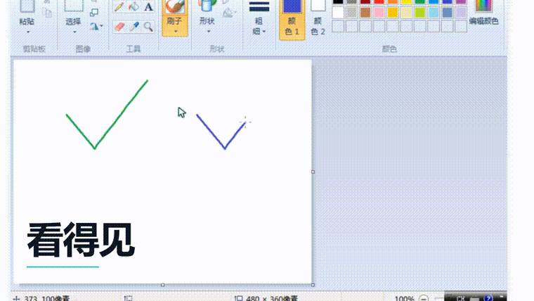

<div align="center">


# use-computer-pro

**让 Agent 真正坐在电脑前 —— 一台，或者很多台。**

控制本机窗口，也控制机器里面跑着的虚拟机。看见屏幕、移动鼠标、点中元素、敲下文字，
并且每一步之后都回头确认：这件事真的发生了。

[](SKILL.md)
[](#通道选型)
[](#通道选型)
[](LICENSE)

</div>

---

## 它能做什么

不是"调用某个 API"，而是**代替一双手**：看屏幕、动鼠标、点按钮、打字、拖拽、截图留证。
这些动作既能作用在你正在用的这台电脑上，也能作用在 VMware 里跑着的客户机上 —— 而且可以同时。

<p align="center">
  
</p>

<p align="center">
  <a href="https://github.com/LeastBit/use-computer-pro/releases/tag/v1.0.0">
    
  </a>
</p>

### 演示一：单机 —— 它自己画完，自己保存

一台 Windows 7，没有人碰过键盘鼠标：

```
移动鼠标 → 点击「刷子」→ 点击调色板换色 → 拖拽落笔 ×4 → Ctrl+S → 点击「保存(S)」
```

屏幕上留下两个对勾，文件保存成 `two-hosts-ok.png`。每一个动作之后都重新截屏确认结果。

### 演示二：双机 —— 一台打，另一台蓝屏

两台机器，一条指令链，全程零人工：

```
Kali   : use auxiliary/dos/windows/rdp/ms12_020_maxchannelids
         set RHOSTS 192.168.6.129
         run
Win7   : [*] Sending MS12-020 ... 210 bytes sent
         → PAGE_FAULT_IN_NONPAGED_AREA (RDPWD.SYS)  STOP: 0x00000050
```

左边在打字，右边在两秒内蓝屏。这不是脚本调 API，是**一只手同时按在两台机器上**。

---

## 为什么这件事不简单

让模型"操作电脑"不难，让它**稳定地**操作电脑很难。真实翻车集中在三处：

| 症状 | 真正的原因 |
|---|---|
| 点击十次全落空 | 截图被缩放，按"看到的像素"取坐标，实际偏了 1.18 倍 |
| 流程跑到一半断了 | 一个弹窗抢走焦点，按键打进了别的窗口 |
| 重连后第一句话就出事 | 新连接只恢复了管道，没有恢复焦点 —— 按键进了桌面搜索框 |

这些都不是模型能力问题，是工程问题。本技能给的是**通道选型 + 坐标换算 + 动作校验 + 故障归因**这一整套方法。

---

## 通道选型

> **口诀**：能用 UI 树就不用坐标；能用客户机执行就不用模拟键盘；能用 VNC 就不用控制台。

| 场景 | 首选 | 备选 | 备注 |
|---|---|---|---|
| 本机 Windows 应用 | `windows-mcp` Snapshot + Click/Type | `windows-control` 脚本 | MCP 能拿到元素 label，比坐标稳 |
| 本机批量 / 脚本化 | `scripts/*.py` | MCP | 一次命令做一串动作更省调用 |
| 虚拟机里的客户机 | 客户机 VNC（键鼠 + 画面） | 控制台 + SendInput | 控制台注入极不稳定 |
| 客户机里跑命令 / 取文件 | `vmrun` guest ops | 客户机内起 HTTP 服务 | 需要 VMware Tools |
| 多台机器同屏 | noVNC 监控墙（`examples/wall`） | 多个 VNC 客户端 | VMware 多开只会变成标签页 |
| Linux 桌面 | `xdotool` + `import` | VNC | 见脚本说明 |

### 闭环

```
看见屏幕  →  决定动作  →  执行输入  →  再看一次
    ↑                                    │
    └────────── 不符合预期则重判 ←────────┘
```

硬性要求：**一个动作一次校验**。连续盲点三次以上，几乎一定是通道或坐标错了，停下来重判，不要靠加重试次数蒙过去。

---

## 快速开始

```bash
git clone https://github.com/LeastBit/use-computer-pro.git \
  ~/.workbuddy/skills/use-computer-pro

pip install pyautogui pywinauto pygetwindow pillow numpy

# VNC 通道（Linux 客户机，先确认 vmx 里已配好端口与密码）
export VNC_PORT=5911 VNC_PASS=vkali
python scripts/vnc_ctl.py size          # 探到画面尺寸即表示通了
python scripts/vnc_ctl.py shot /tmp/a.png
python scripts/vnc_ctl.py click 400 300
python scripts/vnc_ctl.py drag 100 100 500 400

# 长连接采集（录屏 / 连续操作），首帧全量、之后增量
python scripts/vnclive.py
```

客户机侧如果装了 VMware Tools，`vmrun` 的 guest ops 通道最省事：

```bash
vmrun -T ws -gu kali -gp kali runProgramInGuest "<vmx>" /bin/uname -a
```

多机同屏 + 30fps 录制，见 [`examples/wall`](examples/wall)（noVNC + 一个三十行的 WebSocket↔TCP 桥）。

---

## 故障速查（全部来自实测）

| 症状 | 真正的原因 | 处理 |
|---|---|---|
| 重连后打字打进了别的地方 | 新连接没有拿到焦点 | 先 click 窗体内一个安全点，再发按键 |
| 第二次全量请求后不再回帧 | 连续两次 `incremental=0` 被服务端丢弃 | 首帧全量，之后只用增量 |
| 客户机改分辨率 / 崩溃后 VNC 断 | 帧缓冲尺寸变了 | 自动重连 + 重新申请全量 |
| `vmrun` 报「未找到文件」 | Git Bash 改写 `/bin/bash` | `export MSYS_NO_PATHCONV=1`，vmx 用反斜杠路径 |
| 客户机内截图纯黑 | VMware 3D 加速开启 | vmx 加 `mks.enable3d = "FALSE"` |
| 密码正确却退回登录界面 | 两个 X server，控制台停在 greeter 的 VT | `loginctl activate <id>` |
| 关了形状面板却画不出图 | 面板选完不自动关闭，第一次点击只关面板 | 先 `Esc`，再拖拽 |
| 录屏进剪辑软件后"找不到帧" | `gdigrab` 输出 VFR（29.89fps） | 先 `-fps_mode cfr -r 30` 重编码 |
| 中文输入全是问号 | 键盘注入只认 keysym | 走剪贴板粘贴 |

完整排查树见 [`references/troubleshooting.md`](references/troubleshooting.md)，
协议细节见 [`references/vmware-internals.md`](references/vmware-internals.md)，
方法论全文见 [`SKILL.md`](SKILL.md)。

---

## 仓库结构

```
SKILL.md                     方法论全文（12 节，含 60+ 条实测结论）
references/
  troubleshooting.md         排查树
  vmware-internals.md        RFB / VIX 协议细节
scripts/
  vnc_ctl.py                 单次 VNC 操作（shot / click / drag / key / text）
  vnclive.py                 长连接采集（增量帧 + 指针位置）
  vm_guest.py                vmrun 封装（exec / put / get / shot）
  des.py                     VNC 认证用的 DES（纯 Python）
examples/wall/               多机监控墙（noVNC + WebSocket→TCP 桥）
assets/logo.png
```

---

## 边界

这套东西**不适合**：

- 需要临场判断的任务 —— 它没有你的领域知识
- 对排版精度要求极高的交付 —— 像素误差会累积
- 没有回退路径的破坏性操作 —— 删除、格式化、批量改名一律先确认

以及一个诚实的提醒：**控制台注入（向虚拟机窗口直接发键鼠）是三条通道里最不可靠的一条**。
本机实测中，当 VMware 以更高权限运行时，鼠标和键盘事件都会被拦在客机之外。
这就是为什么技能把 VNC 和 guest ops 排在它前面。

---

## 致谢

这套方法不是凭空长出来的，它站在这些项目与经验之上：

- [noVNC](https://github.com/novnc/noVNC) —— 浏览器里的 VNC 客户端，多机同屏的基础
- [windows-mcp](https://github.com/windows-mcp) —— 本机 UI 树与输入原语
- [pyautogui](https://github.com/asweigart/pyautogui) · [pywinauto](https://github.com/pywinauto/pywinauto) —— 本机输入注入与 UI Automation
- [Remotion](https://github.com/remotion-dev/remotion) · [FFmpeg](https://ffmpeg.org) —— 演示视频的合成与录制
- VMware VIX / RFB 协议文档 —— 虚拟机通道的全部依据

以及那些在真实机器上翻过的车：坐标偏 1.18 倍、VNC 握手 EOF、`SetEncodings` 静默挂起、
`mks.enable3d` 黑屏、重连丢焦点、VFR 找不到帧 —— 它们现在都是上面那张表里的一行。

---

## License

MIT © [LeastBit](https://github.com/LeastBit)
